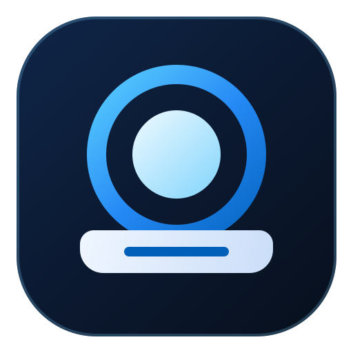
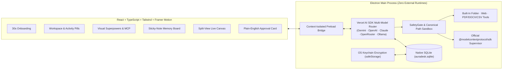

<div align="center">
  

  # AuraDesk

  **The calm, zero-friction AI desktop workspace built for real people.**  
  *1-click install · Zero JSON config · Zero terminal · Multi-model + Offline Local AI · Plain-English safety.*

  [](../../releases/latest)
  [](../../releases/latest)
  [](../../releases/latest)
  [](LICENSE)
</div>

---

## Why AuraDesk Exists

Powerful AI desktop agents shouldn't require a Computer Science degree, Docker containers, Python virtual environments, or hand-editing `claude_desktop_config.json` with escaped backslashes.

**AuraDesk** gives anyone—writers, researchers, founders, students, analysts, and developers alike—a fast, private, Apple-grade desktop studio that works immediately after downloading a single installer:

- **No vendor lock-in:** Bring **Google Gemini**, **OpenAI**, **Anthropic Claude**, **OpenRouter**, or click **"Auto-Detect Local AI (Ollama)"** to run 100% offline for free.
- **No external runtimes:** Built-in folder organization, live web research, PDF/Word/CSV analysis, and local SQLite memory ship right inside the app—no Docker, no Python, no CLI.
- **No scary black-box actions:** Every file creation, edit, move, or external connector action pauses with a calm, plain-English approval card (**Allow Once**, **Trust This Folder**, or **Block**).

---

## Breakthrough Features

### 1. 30-Second Visual Onboarding Wizard
Launch AuraDesk, paste a single API key (stored encrypted inside your OS keychain) **or** click **Auto-Detect Local AI (Ollama)** with live latency verification—or jump straight into **Guided Demo Mode** to explore every screen immediately.

### 2. 1-Click Superpowers & Visual MCP App Store
Zero curly braces `{}` or broken config paths:
- **Smart Folder Assistant:** Pick the exact folders AuraDesk is allowed to see via your native OS folder picker.
- **Live Web Research & Page Reader:** Searches live web sources and strips ads and clutter into clean readable articles.
- **Document & PDF Analyst:** Drag and drop `.pdf`, `.docx`, `.csv`, `.tsv`, or `.md` files directly onto the chat composer for instant summaries, tables, and column math.
- **Visual MCP Connector:** Connect Notion, GitHub, or custom Model Context Protocol servers via a friendly visual form with automatic background process cleanup.

### 3. Plain-English Safety & Trust Guardrails
Whenever AuraDesk wants to create a folder, write a summary file, rename documents, or move clutter to your system Recycle Bin / Trash, execution pauses and displays:
- **What** will happen in plain English
- **Why** AuraDesk is asking (plus an expandable preview of the exact content)
- One-click **[Allow Once]**, **[Trust This Folder]**, or **[Block]** controls

### 4. Live Visual Memory Board
Open the collapsible right-hand **Memory** drawer anytime to view *"What AuraDesk Remembers About You"* as editable sticky-note cards saved locally in SQLite. Pin, edit inline, add, or delete any memory in 1 click.

### 5. 1-Click Workflow Studio
Run pre-loaded everyday skills in a single click—**Clean & Organize My Folder**, **Deep Internet Research Report**, **Summarize & Extract Action Items**, and **Draft & Polish Content**—or save your own custom workflows visually.

### 6. Split-View Artifact & Live Preview Canvas
Reports, formatted Markdown tables, code, and interactive HTML webpages open automatically in a clean right-hand **Canvas** where you can preview live, edit directly, copy, or export in 1 click to **PDF**, **Markdown (`.md`)**, or **HTML (`.html`)**.

### 7. Studio Daylight & Warm Obsidian UI
Seamless Light & Dark modes, live plain-English tool activity pills (*"Looking inside your Downloads folder..."*, *"Reading clean article..."*), keyboard shortcuts (`Ctrl/Cmd + N`, `Ctrl/Cmd + M`), and full `prefers-reduced-motion` accessibility.

---

## Architecture



---

## How AuraDesk Compares

| Capability | Claude Desktop | Cline / OpenCode | OpenHands / Hermes | **AuraDesk** |
| :--- | :---: | :---: | :---: | :---: |
| **1-Click Native Desktop App** | Yes | IDE / CLI | Docker / Server | **Yes (`.exe`, `.dmg`, `.AppImage`)** |
| **Multi-Provider + Local Ollama** | Locked to Claude | Yes | Yes | **Yes (1-Click Switcher)** |
| **Zero JSON MCP Setup** | Raw JSON | Raw JSON | CLI / YAML | **Visual Form + Presets** |
| **Zero Docker / Python Required** | Partial (for MCPs) | Needs Node/Git | Needs Docker | **100% Self-Contained** |
| **Plain-English Folder Guardrails** | Technical | Diff / Shell | Container ACLs | **Allow Once / Trust Folder / Block** |
| **Visual Editable Memory Board** | Cloud / Opaque | None | Server Files | **Local SQLite Sticky Cards** |
| **1-Click PDF / HTML / MD Canvas** | Copy / Download | Editor Tabs | Raw Files | **Live Edit + Native PDF Export** |

---

## 60-Second Quickstart

### For Everyday Users (Zero Terminal)
1. Visit the [**Releases**](../../releases/latest) page and download the installer for your computer:
   - **Windows:** `AuraDesk-Setup-1.0.0-Windows.exe`
   - **macOS (Apple Silicon & Intel):** `AuraDesk-1.0.0-macOS-Universal.dmg`
   - **Linux:** `AuraDesk-1.0.0-Linux-x86_64.AppImage`
2. Open **AuraDesk**.
3. Paste any API key (Gemini, OpenAI, Claude, or OpenRouter), click **Auto-Detect Local AI (Ollama)**, or click **Explore Guided Demo Mode**—and start working immediately.

### For Developers & Contributors
```bash
# 1. Clone and install dependencies
git clone https://github.com/YOUR_USERNAME/auradesk.git
cd auradesk
npm install

# 2. Typecheck, run tests, and launch AuraDesk locally
npm run typecheck
npm test
npm run preview:desktop

# 3. Build a 1-click installer for your current OS
npm run dist
```

### Publishing Automated Multi-OS Releases on GitHub
AuraDesk includes a ready-to-run GitHub Actions pipeline ([`.github/workflows/release.yml`](.github/workflows/release.yml)) that compiles Windows `.exe`, macOS Universal `.dmg`, and Linux `.AppImage` installers automatically whenever you push a version tag:

```bash
git remote add origin https://github.com/YOUR_USERNAME/auradesk.git
git push -u origin main
git tag v1.0.0
git push origin v1.0.0
```

---

## Documentation
- [**Live Competitor & UX Friction Research (`RESEARCH.md`)**](RESEARCH.md)
- [**System Architecture & Product Blueprint (`SPEC.md`)**](SPEC.md)

## License
Released under the [MIT License](LICENSE).
