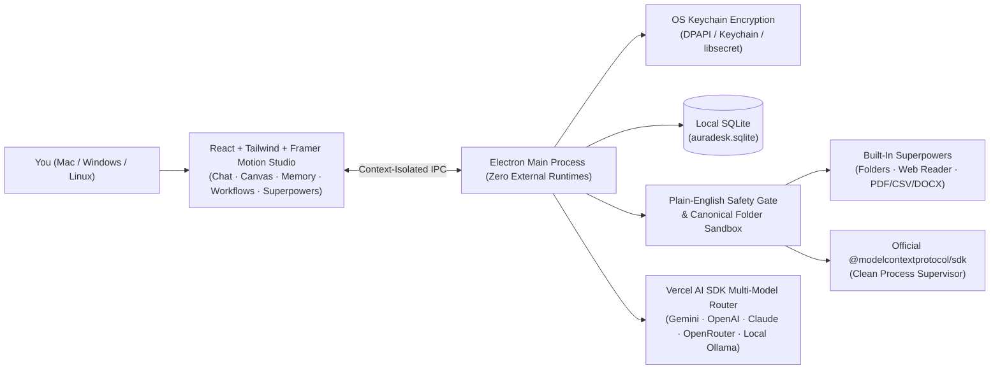

<div align="center">
  

  # AuraDesk

  **Your calm, private AI desktop workspace — ready in one click.**  
  *No terminal. No Docker. No raw JSON config files. Ever.*

  [](https://github.com/syedabdulkareempersonal-sketch/nexus-harness/releases/latest)
  [](https://github.com/syedabdulkareempersonal-sketch/nexus-harness/releases/latest)
  [](https://github.com/syedabdulkareempersonal-sketch/nexus-harness/releases/latest)

  [](LICENSE)
  [](SPEC.md)
  [](SPEC.md)
</div>

---

## Why AuraDesk Exists

Powerful AI desktop tools today force an impossible choice:
- **Consumer chat apps** (like Claude Desktop) lock you into one vendor's paid subscription and force you to hand-edit fragile `claude_desktop_config.json` files just to connect basic local tools.
- **Agent harnesses** (like OpenHands, OpenCode, Cline, or OpenClaw) expect you to install **Docker**, **VS Code**, **Python**, or approve scary terminal commands (`rm -rf`, `EINVAL`, raw JSON schemas).

**AuraDesk** was built from the ground up so **any person in the world**—writers, researchers, founders, students, analysts, and developers alike—can download a 1-click installer and immediately have a safe, superhuman workspace on their own computer.

---

## Breakthrough Features

### 1. 30-Second Visual Onboarding (Bring Any AI or Run 100% Offline)
- Paste **1 API key** (**Google Gemini**, **OpenAI**, **Anthropic Claude**, or **OpenRouter**) encrypted directly in your operating system's native keychain (`safeStorage`).
- **OR** click **Auto-Detect Local AI (Ollama)** to discover models running privately on your own machine (`llama3.2`, `qwen2.5`, `gemma3`, `mistral`) with zero cloud cost.
- **OR** explore **Guided Demo Mode** right out of the box before connecting a key.

### 2. 1-Click Superpowers & Visual MCP App Store (Zero JSON)
- **Smart Folder Assistant:** Choose exactly which folders AuraDesk can see via your native OS folder picker. AuraDesk cannot touch anything outside folders you share.
- **Live Web Research & Clean Page Reader:** Built-in web search and clutter-free article extraction—no search API key required.
- **Document & PDF Analyst:** Drag and drop `.pdf`, `.docx`, `.csv`, `.tsv`, or `.md` files right onto the chat composer for instant summaries, tables, and column totals.
- **Visual MCP Connector:** Connect Notion, GitHub, or custom Model Context Protocol servers with a friendly visual form—never edit a curly brace `{}` again.

### 3. Plain-English Safety & Trust Guardrails
Whenever AuraDesk wants to create, edit, move, or trash a file—or run an external connector action—it pauses and displays a calm human-readable approval card explaining **what** will happen and **why**:
- **[Allow Once]** · **[Trust This Folder]** · **[Block]**
- File removal exclusively uses your system **Recycle Bin / Trash**, never permanent deletion.

### 4. Live Visual Memory Board
Open the right-hand **Memory** drawer anytime to see *"What AuraDesk Remembers About You"* as editable sticky-note cards stored locally in SQLite. Pin, edit, add, or delete any memory in 1 click.

### 5. 1-Click Workflow Studio
Launch pre-loaded everyday workflows—**Clean & Organize My Folder**, **Deep Internet Research Report**, **Summarize & Extract Action Items**, and **Draft & Polish Content**—or save your own custom workflows visually.

### 6. Split-View Artifact & Live Preview Canvas
Reports, tables, code, and interactive webpages open side-by-side in a clean **Canvas** where you can **Edit** directly, **Copy**, or **Export in 1 Click** to **PDF**, **Markdown (`.md`)**, or **Webpage (`.html`)**.

---

## How AuraDesk Works Under the Hood



---

## 60-Second Quickstart

### For Everyday Users (Zero Terminal)
1. Go to the [**Releases**](https://github.com/syedabdulkareempersonal-sketch/nexus-harness/releases/latest) page.
2. Download the 1-click installer for your computer:
   - **Windows:** `AuraDesk-Setup-1.2.0.exe`
   - **macOS (Apple Silicon & Intel Universal):** `AuraDesk-1.2.0-Universal.dmg`
   - **Linux:** `AuraDesk-1.2.0-x86_64.AppImage`
3. Open **AuraDesk**, paste 1 API key (AuraDesk automatically discovers every live model on your account!) or click **Auto-Detect Local AI**, and start working!

### For Developers & Contributors
```bash
# 1. Clone and install dependencies
git clone https://github.com/syedabdulkareempersonal-sketch/nexus-harness.git
cd nexus-harness
npm install --foreground-scripts

# 2. Build icons, React studio, and Electron bundles, then launch
npm run preview:desktop

# 3. Run TypeScript checks & automated security/SQLite test suite
npm run typecheck
npm test

# 4. Build native 1-click installers locally
npm run dist:win    # Windows .exe (NSIS)
npm run dist:mac    # macOS Universal .dmg
npm run dist:linux  # Linux .AppImage
```

---

## Publishing a New GitHub Release (`v1.2.0`)

AuraDesk includes a pre-configured GitHub Actions pipeline in [`.github/workflows/release.yml`](.github/workflows/release.yml). Pushing any `v*` tag automatically builds and attaches the Windows `.exe`, macOS Universal `.dmg`, and Linux `.AppImage` installers to a public GitHub Release:

```bash
git remote add origin https://github.com/syedabdulkareempersonal-sketch/nexus-harness.git
git push -u origin main
git tag v1.2.0
git push origin v1.2.0
```

---

## Product Documentation
- [**Live Competitor & UX Friction Research (`RESEARCH.md`)**](RESEARCH.md)
- [**System Architecture & UI/UX Blueprint (`SPEC.md`)**](SPEC.md)

---

## License

Released under the [MIT License](LICENSE). Built for humans everywhere.
