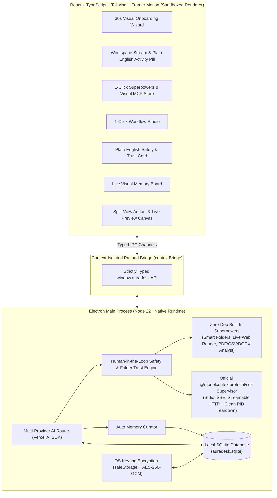

# AuraDesk — Product Architecture & UI/UX Specification (`SPEC.md`)

**Brand Name:** **AuraDesk**  
**Tagline:** *Your calm, private AI workspace—ready in one click.*  
**Why AuraDesk:** Whereas "Aether" sounds abstract and collides with developer/crypto tooling, **AuraDesk** immediately tells any non-technical person what the product is: an intelligent, luminous assistant (*Aura*) grounded right on their personal computer workspace (*Desk*).

---

## 1. Brand Identity & Custom SVG App Mark

### Visual Concept: The Aperture Desk Mark
AuraDesk's custom vector mark combines two timeless physical metaphors:
1. **Luminous Concentric Aperture:** Soft concentric rings representing clarity, calm focus, and local intelligence radiating from the user's own machine.
2. **Tactile Studio Horizon:** A grounded architectural desk plane cradling the light, symbolizing safety, stability, and ownership over personal files and memories.

The SVG mark is engineered on a 64×64 optical grid with clean geometry that scales effortlessly from a 16px system tray icon to a 512px macOS/Windows desktop icon.

### Color & Material System ("Studio Daylight & Warm Obsidian")
Designed around real human workspaces—sunlit desk paper by day, low-glare studio obsidian at night—with WCAG AA+ contrast across all surfaces:

| Semantic Token | Light Mode (Studio Daylight) | Dark Mode (Warm Obsidian) | Purpose |
| :--- | :--- | :--- | :--- |
| `--bg-canvas` | `#FAF8F5` | `#111215` | Primary workspace background |
| `--bg-surface` | `#FFFFFF` | `#181A1F` | Cards, Canvas sheet, active composer |
| `--bg-subtle` | `#F2EFE9` | `#20232B` | Left navigation rail, inactive pills, hover wells |
| `--fg-primary` | `#18181B` | `#F4F2EE` | Primary headings & readable body copy (>13:1 contrast) |
| `--fg-secondary` | `#524E48` | `#B4B0A8` | Warm-tinted secondary descriptions (≥5.2:1 contrast) |
| `--fg-muted` | `#736E65` | `#8A857C` | Timestamps & metadata (≥4.5:1 contrast) |
| `--accent-primary` | `#B8501E` | `#E8844A` | Primary actions, active toggles, focus rings |
| `--accent-soft` | `#FCEEE6` | `#2E1F17` | Subtle highlight fills & active workflow badges |
| `--trust-safe` | `#1B724E` | `#34D399` | Verified connections, trusted folders, safe read status |
| `--warn-amber` | `#9A5B13` | `#FBBF24` | Plain-English safety approval cards |
| `--danger-red` | `#B91C1C` | `#F87171` | Destructive action warnings & block buttons |
| `--border-hairline` | `rgba(24, 24, 27, 0.09)` | `rgba(244, 242, 238, 0.09)` | Crisp 1px structural separation |

### Typography & Craft Floor Discipline
- **Font Stack:** Clean native optical system stack (`Inter`, `-apple-system`, `BlinkMacSystemFont`, `'Segoe UI Variable Display'`, `system-ui`, `sans-serif`) with `JetBrains Mono` / `'Cascadia Mono'` / `ui-monospace` reserved strictly for code artifacts and data measurements.
- **Optical Rules:**
  - Large headings: `letter-spacing: -0.025em`, `line-height: 1.15`, `text-wrap: balance`. Zero uppercase kickers/eyebrows above headings.
  - Body prose: `15px–16px`, `line-height: 1.65`, capped at `65ch` reading measure for effortless comprehension.
  - Dynamic numbers & counters: `font-variant-numeric: tabular-nums`.
  - Tactile controls: `transform: scale(0.97)` on `:active` (`140ms cubic-bezier(0.23, 1, 0.32, 1)`), explicit property transitions (`transform`, `opacity`), zero `transition: all`, and full `@media (prefers-reduced-motion: reduce)` support.
  - Browser surfaces themed: Custom subtle scrollbars, palette-matched `::selection`, caret color, and `2px` offset `:focus-visible` rings.

---

## 2. Zero-Dependency System Architecture

AuraDesk ships as a self-contained native Electron application requiring **zero external runtimes** (no Docker, no Python, no Node CLI, no terminal commands).



### Security Boundaries
1. **Electron Hardening:** `contextIsolation: true`, `nodeIntegration: false`, `sandbox: true` on renderer windows; external links open safely in the user's default browser via `shell.openExternal` after protocol allowlist validation (`https:` / `http:` only).
2. **OS Keychain Secret Protection:** API keys and MCP secret environment variables are encrypted before touching disk via Electron's `safeStorage` API (DPAPI on Windows, Keychain on macOS, Secret Service/libsecret on Linux, with machine-derived AES-256-GCM fallback in headless environments). Raw keys are never sent back to the renderer after saving—only masked hints (`sk-...9f2a`).
3. **Scoped File System Sandboxing:** The Smart Folder Assistant cannot read arbitrary system paths. It can only access directories explicitly chosen by the user via the native OS folder picker (`dialog.showOpenDialog`), verified with canonical `fs.realpath` containment checks to prevent symlink or `../` traversal.
4. **Safe Deletion Only:** File removal never calls `fs.unlink`—it uses Electron's `shell.trashItem(path)` so users can always recover items from their Recycle Bin / Trash, and even moving to Trash requires explicit approval via the Safety Card.

---

## 3. Local SQLite Schema (`auradesk.sqlite`)

Stored in `app.getPath('userData')/auradesk.sqlite` using Node's built-in `node:sqlite` (`DatabaseSync` shipped natively inside Electron's Node 22+ runtime—eliminating C++ `node-gyp` build failures and enabling universal macOS/Windows/Linux packaging):

```sql
-- App Preferences & Onboarding State
CREATE TABLE IF NOT EXISTS settings (
  key TEXT PRIMARY KEY,
  value TEXT NOT NULL,
  updated_at TEXT NOT NULL
);

-- Encrypted Provider Credentials & Active Model Selection
CREATE TABLE IF NOT EXISTS providers (
  id TEXT PRIMARY KEY,              -- 'google' | 'openai' | 'anthropic' | 'openrouter' | 'ollama' | 'demo'
  display_name TEXT NOT NULL,
  encrypted_api_key TEXT,           -- Encrypted via safeStorage
  key_hint TEXT,                    -- Masked e.g. 'AIza...8kQ1'
  base_url TEXT,                    -- Custom or Ollama http://127.0.0.1:11434/v1
  selected_model TEXT NOT NULL,
  is_verified INTEGER DEFAULT 0,
  updated_at TEXT NOT NULL
);

-- Conversations
CREATE TABLE IF NOT EXISTS conversations (
  id TEXT PRIMARY KEY,
  title TEXT NOT NULL,
  workflow_id TEXT,
  pinned INTEGER DEFAULT 0,
  created_at TEXT NOT NULL,
  updated_at TEXT NOT NULL
);

-- Chat Messages (User, Assistant, Plain-English Tool Summaries)
CREATE TABLE IF NOT EXISTS messages (
  id TEXT PRIMARY KEY,
  conversation_id TEXT NOT NULL REFERENCES conversations(id) ON DELETE CASCADE,
  role TEXT NOT NULL,               -- 'user' | 'assistant'
  content TEXT NOT NULL,
  tool_activities_json TEXT,        -- Plain-English tool steps & outcomes
  attachments_json TEXT,            -- Dropped PDFs/CSVs/DOCX metadata
  artifact_ids_json TEXT,           -- Linked Canvas artifact IDs
  created_at TEXT NOT NULL
);

-- Live Visual Memory Board ("What AuraDesk Remembers About You")
CREATE TABLE IF NOT EXISTS memories (
  id TEXT PRIMARY KEY,
  content TEXT NOT NULL,
  category TEXT NOT NULL,           -- 'About You' | 'Preferences' | 'Projects' | 'Important'
  color_tag TEXT NOT NULL,          -- 'amber' | 'sage' | 'sky' | 'rose'
  pinned INTEGER DEFAULT 0,
  source_conversation_id TEXT,
  created_at TEXT NOT NULL,
  updated_at TEXT NOT NULL
);

-- Scoped Folders & Plain-English Trust Rules
CREATE TABLE IF NOT EXISTS allowed_folders (
  id TEXT PRIMARY KEY,
  folder_path TEXT UNIQUE NOT NULL,
  label TEXT NOT NULL,
  trust_mode TEXT NOT NULL DEFAULT 'ask', -- 'ask' (approve writes) | 'trusted' (auto-allow safe writes inside folder)
  created_at TEXT NOT NULL
);

-- Built-In Superpowers & Visual MCP Connectors
CREATE TABLE IF NOT EXISTS mcp_servers (
  id TEXT PRIMARY KEY,
  name TEXT NOT NULL,
  description TEXT NOT NULL,
  transport TEXT NOT NULL,          -- 'stdio' | 'sse' | 'streamable-http'
  command TEXT,                     -- For stdio
  args_json TEXT,                   -- Array of string arguments
  url TEXT,                         -- For sse / streamable-http
  encrypted_env_json TEXT,          -- Encrypted key-value map
  env_keys_json TEXT,               -- Non-secret list of configured key names
  enabled INTEGER DEFAULT 1,
  last_status TEXT DEFAULT 'idle',  -- 'connected' | 'error' | 'idle'
  last_error TEXT,
  created_at TEXT NOT NULL
);

-- 1-Click Workflow Studio (Pre-loaded + User Custom Skills)
CREATE TABLE IF NOT EXISTS workflows (
  id TEXT PRIMARY KEY,
  title TEXT NOT NULL,
  description TEXT NOT NULL,
  icon_name TEXT NOT NULL,
  category TEXT NOT NULL,
  prompt_template TEXT NOT NULL,
  required_tools_json TEXT NOT NULL,
  output_artifact_hint TEXT,
  is_builtin INTEGER DEFAULT 0,
  created_at TEXT NOT NULL
);

-- Split-View Canvas Artifacts
CREATE TABLE IF NOT EXISTS artifacts (
  id TEXT PRIMARY KEY,
  conversation_id TEXT REFERENCES conversations(id) ON DELETE SET NULL,
  title TEXT NOT NULL,
  kind TEXT NOT NULL,               -- 'markdown' | 'html' | 'table' | 'code'
  language TEXT,
  content TEXT NOT NULL,
  created_at TEXT NOT NULL,
  updated_at TEXT NOT NULL
);
```

---

## 4. Detailed UX Blueprint of the 7 Breakthrough Features

### Feature 1: 30-Second Visual Onboarding Wizard
- **Screen Layout:** Centered, calm daylight card over a soft ambient studio backdrop—zero account login, zero telemetry nags.
- **Step 1 (Connect Intelligence in 1 Click):**
  - Four friendly provider tabs (**Google Gemini**, **OpenAI**, **Anthropic Claude**, **OpenRouter**) with a single password input, a direct "Where do I get a free key?" helper link, and a **[Verify & Connect]** button that runs a live handshake and displays latency (`Connected in 340ms`).
  - **OR** prominent **1-Click Local AI Card**: **[Auto-Detect Local AI (Ollama)]**—scans `127.0.0.1:11434`, lists discovered local models (`llama3.2`, `qwen2.5`, etc.) automatically, and connects 100% offline.
  - **OR** **[Explore Guided Demo Mode]**—lets any user test every feature of AuraDesk immediately even before obtaining an API key.
- **Step 2 (Choose Your First Safe Folder — Optional):**
  - 1-click native folder picker (*"Let AuraDesk help organize a folder, like Downloads or Desktop—you stay in full control"*).
- **Step 3 (Ready to Go):** Drops straight into the clean workspace with 4 starter workflow cards ready to click.

### Feature 2: 1-Click Visual Tool & MCP App Store ("Superpowers")
Accessible from the left sidebar (`Superpowers` tab), divided into two clear visual zones:
1. **Built-In Superpowers (Zero Setup, Instant ON/OFF Switches):**
   - **Smart Folder Assistant:** Shows connected folders as pills + **[+ Add Folder]** button opening the native OS folder dialog, plus per-folder trust toggle (`Ask before changes` vs `Trusted folder`).
   - **Live Web Research & Page Reader:** Toggle ON/OFF. Searches the live web and extracts clean, ad-free articles.
   - **Document & PDF Analyst:** Toggle ON/OFF. Reads `.pdf`, `.docx`, `.csv`, `.tsv`, `.md`, and `.txt` files dropped right into chat.
2. **Add Custom App Connector (Visual MCP Form — Zero Raw JSON):**
   - One-click preset templates (e.g., *Notion*, *GitHub*, *Linear*, *Local SQLite/Postgres*, *Custom Web MCP*) OR custom friendly form:
     - **Connector Name** (e.g., `"Company Knowledge Base"`)
     - **Connection Method** (`Web URL` or `Local App Command`)
     - **Address or Command** (plain text input—no escaping backslashes or curly braces!)
     - **Secret Keys** (friendly `+ Add Secret Key` rows with `Key Name` + masked `Secret Value`)
   - Live **[Test Connection]** button showing discovered capabilities in plain English (e.g., *"Connected — 4 actions ready"*).

### Feature 3: Plain-English Safety & Trust Guardrails
Whenever the AI attempts any mutating or external action (`create_file`, `modify_file`, `move_or_rename_file`, `move_to_trash`, `create_subfolder`, or an external MCP tool invocation):
1. The main-process `SafetyGuardrail` pauses execution on a Promise awaiting user resolution.
2. The UI slides in a calm, unmistakable **Safety Approval Card** right above the composer:
   - **Plain-English Headline:** e.g., *"Create a new file in your Documents folder?"*
   - **What will happen:** *"AuraDesk will save `Q4-Budget-Summary.md` inside `C:\Users\...\Documents\Reports`."*
   - **Why AuraDesk wants to do this:** Plain-English explanation passed from the tool intent + expandable preview of the exact content/change.
   - **Three Clear Choices:**
     - **[Allow Once]** — Executes this single action and continues streaming.
     - **[Trust This Folder]** — Marks this specific folder as trusted for safe file organization (revocable anytime in Superpowers) and continues.
     - **[Block]** — Cancels the action safely and tells the AI the user declined so it can offer an alternative in chat.

### Feature 4: Live Visual Memory Board
- Collapsible right-hand drawer toggled via the top bar (**Memory** button with count badge, `tabular-nums`).
- Displays **"What AuraDesk Remembers About You"** as tactile sticky-note cards on warm tinted surfaces.
- Each card supports:
  - **1-Click Pin** (keeps core preferences prioritized at the top of AI context)
  - **Inline Click-to-Edit** (fix or refine any remembered fact immediately)
  - **1-Click Delete** (instant local removal from SQLite)
  - **[+ Remember Something New]** quick input bar at the top of the drawer.
- After assistant responses, a non-blocking background pass extracts genuine durable user facts (e.g., name, role, formatting preferences, ongoing projects) without slowing down chat streaming.

### Feature 5: 1-Click Workflow Studio (Skills)
- Accessible from both the empty-chat home screen and the dedicated **Workflows** view in the sidebar.
- Ships with 4 flagship pre-loaded visual workflows:
  1. **Clean & Organize My Folder** — Inspects a chosen folder, groups cluttered files into sensible subfolders by topic/type, and asks permission before moving a single file.
  2. **Deep Internet Research Report** — Searches live web sources, reads full pages, synthesizes findings with citations, and opens a polished report in the Canvas.
  3. **Summarize & Extract Action Items** — Drop any PDF, Word doc, or CSV to extract an executive brief, key numbers, and next steps.
  4. **Draft & Polish Content** — Collaboratively writes and refines documents, proposals, emails, or standalone HTML pages inside the split-view Canvas.
- Includes **[Create Custom Workflow]** visual modal: pick an icon, name your workflow, write plain-English instructions, check which Superpowers it should use, and save to SQLite in 1 click.

### Feature 6: Split-View Artifact & Live Preview Canvas
- Whenever the AI calls `open_in_canvas` (or generates a substantial report, markdown document, data table, or interactive HTML page), the workspace smoothly splits into a **Conversation + Canvas** two-pane studio.
- **Canvas Toolbar:**
  - Artifact switcher dropdown (when a chat produces multiple versions/documents)
  - **[Preview]** vs **[Edit]** mode toggle (edits persist live to SQLite)
  - **1-Click Copy** (with instant checkmark feedback)
  - **1-Click Export Menu:** **Save as PDF (`.pdf`)** (via Electron `printToPDF`), **Save as Markdown (`.md`)**, and **Save as Webpage (`.html`)**.

### Feature 7: Plain-English Live Activity Indicators & Zero Jargon
- Every internal tool maps to a human-readable activity formatter:
  - `list_folder` -> *"Looking inside your Downloads folder..."*
  - `read_document` -> *"Reading `Annual-Report.pdf`..."*
  - `web_search` -> *"Searching the web for recent sources..."*
  - `read_webpage` -> *"Reading clean article from reuters.com..."*
  - `open_in_canvas` -> *"Preparing your document in the Canvas..."*
- Errors never show stack traces or HTTP status codes (`401 Unauthorized` becomes *"Your OpenAI key wasn't accepted. Double-check the key in Settings or switch to Local AI."*).

---

## 5. Project Directory Structure

```text
auradesk/
├── build/                          # App icons (icon.svg, icon.png, icon.ico) & installer assets
├── .github/workflows/release.yml   # Automated Win (.exe), Mac (.dmg universal), Linux (.AppImage) CI
├── src/
│   ├── shared/
│   │   └── types.ts                # Shared TypeScript contracts across Main, Preload, and Renderer
│   ├── main/
│   │   ├── index.ts                # Electron app lifecycle, BrowserWindow, native menus & PDF export
│   │   ├── preload.ts              # Strict contextBridge API exposure
│   │   ├── ipc.ts                  # Typed IPC handlers connecting Renderer <-> Services
│   │   ├── db/
│   │   │   └── database.ts         # SQLite manager (auradesk.sqlite), migrations, & seed workflows
│   │   ├── security/
│   │   │   ├── vault.ts            # OS safeStorage + AES-256-GCM secret encryption
│   │   │   ├── pathGuard.ts        # Canonical realpath folder sandbox validator
│   │   │   └── safetyGate.ts       # Plain-English approval queue (Allow Once / Trust Folder / Block)
│   │   ├── ai/
│   │   │   ├── router.ts           # Vercel AI SDK streaming router (Gemini, OpenAI, Anthropic, OpenRouter, Ollama, Demo)
│   │   │   └── memoryCurator.ts    # Automatic personal memory extractor
│   │   ├── tools/
│   │   │   ├── folderTools.ts      # Safe Smart Folder Assistant tools
│   │   │   ├── webTools.ts         # Live Web Search & Clean Article Reader
│   │   │   ├── documentTools.ts    # Zero-dep PDF, DOCX, CSV, & Text Analyst
│   │   │   └── canvasTools.ts      # Artifact creation & update tools
│   │   └── mcp/
│   │       └── mcpManager.ts       # Official @modelcontextprotocol/sdk client supervisor & PID cleanup
│   └── renderer/
│       ├── index.html
│       ├── main.tsx
│       ├── App.tsx
│       ├── styles/
│       │   └── globals.css         # Studio Daylight & Warm Obsidian tokens, typography, reduced-motion
│       └── components/
│           ├── BrandLogo.tsx       # Custom SVG Aperture Desk Logo
│           ├── OnboardingWizard.tsx
│           ├── Sidebar.tsx
│           ├── ChatWorkspace.tsx
│           ├── SafetyApprovalCard.tsx
│           ├── SuperpowersStore.tsx
│           ├── WorkflowStudio.tsx
│           ├── MemoryDrawer.tsx
│           ├── ArtifactCanvas.tsx
│           ├── SettingsModal.tsx
│           └── ErrorBoundary.tsx
├── scripts/
│   └── generate-icons.mjs          # Generates crisp PNG & Windows ICO icons from custom SVG logo
├── tests/
│   └── core.test.ts                # Automated unit & integration tests (SQLite, Vault, PathGuard, SafetyGate, Parsers)
├── electron-builder.yml            # NSIS (.exe), Universal DMG (.dmg), AppImage (.AppImage) config
├── package.json
├── tsconfig.json
└── vite.config.ts
```
